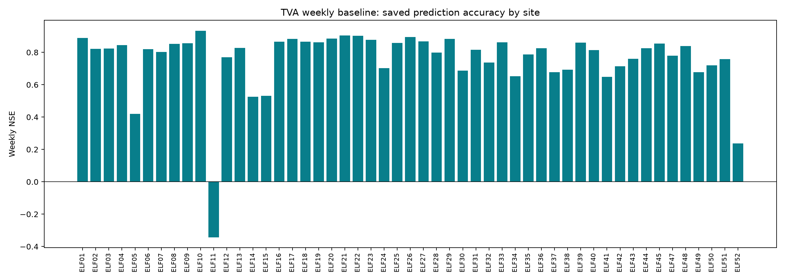

# TVA weekly inflow model

Saved baseline from `tva_elf_headwater_final/lstm_1layer_52site_nonlinear_heads_weekly_cosine`, packaged for people and AI agents. This private repository includes the exact prepared weekly dataset, masks, scalers, trained checkpoints, saved predictions, and original source snapshots. It excludes the later nested experiments and raw gridded archives.

The model shares one LSTM across 52 TVA ELF locations and uses an independent nonlinear head for each site. There is no GNN or attention. Each prediction uses **the target week plus 12 preceding weeks** of basin precipitation, temperature and total runoff, with basin mean elevation repeated at every time step. Output heads are tied to the existing 52 site IDs, so the checkpoint cannot predict a new site without adaptation.

## Run the saved model

Use Python 3.12. Install the matching CPU/CUDA/ROCm build of PyTorch for your platform, then the remaining dependencies. Frontier's original environment uses PyTorch 2.10.0+rocm7.1. The portable inference check uses PyTorch 2.10.0 on CPU.

```bash
python -m venv .venv
source .venv/bin/activate
python -m pip install -r requirements.txt

python pipeline.py inspect
python pipeline.py infer \
  --inputs examples/weekly_inputs.csv \
  --metadata examples/forcing_metadata.json \
  --out outputs/example_inference
python pipeline.py replay --split test --out outputs/test_replay
python pipeline.py plot \
  --predictions outputs/test_replay/predictions.csv \
  --sites ELF13 ELF39 --out outputs/test_figures
```

Output directories must be new and outside `baseline/`. Commands never overwrite an existing output directory or launch training implicitly. `replay` uses the frozen original masks and date split. It checks that the default checkpoint reproduces the saved validation/test rows and predictions within a small cross-platform floating-point tolerance. `infer` needs no ELF observations. `plot` uses saved paired predictions and preserves gaps.

## Inputs and outputs

| Input | Physical units and meaning |
|---|---|
| `basin_id` | Existing trained ID, ELF01–ELF52 |
| `start` | Monday date, YYYY-MM-DD, representing a complete Monday–Sunday week |
| `precipitation_mm_week` | Basin mean weekly precipitation amount, mm/week |
| `temperature_mean_c` | Basin mean weekly mean temperature, °C |
| `total_runoff_mm_week` | Basin mean weekly surface runoff **plus baseflow**, mm/week |
| Static elevation | Stored basin mean elevation in metres |

CSV values stay in physical units. The pipeline applies training-only scalers once. Each site needs at least 13 rows. It skips the first 12 context weeks, flags missing/non-finite or discontinuous input windows, and produces `predicted_mean_mm_day` and `predicted_volume_m3`. Weekly volume is depth-equivalent output × drainage area in km² × **7000**. Area is a conversion factor, not an additional learned static feature. The target is the site's ELF quantity, which can represent local/incremental flow rather than total upstream reservoir inflow.

See the [data contract](skill-authoring-kit/DATA_CONTRACT.md) for masks, units, target semantics and the HEADWATER interface. **Raw HEADWATER NetCDF/map ingestion is not implemented here.** First map gridded fields to the matching ELF drainage areas using overlap-area weights, aggregate to the required weekly units, and supply the CSV interface. Surface-runoff-only maps do not match the trained total-runoff feature. A forecast requires the target week's forecast P/T/runoff, not only preceding historical weeks.

## Frozen settings and results

| Item | Baseline |
|---|---|
| LSTM | 1 layer, hidden size 64 |
| Heads | 52 independent 64 → 16 ReLU → 1 Softplus heads |
| Parameters | 72,884 |
| Dropout | 0.2 before the output heads |
| History | 13 weeks including target week |
| Training | Adam, batch 512, gradient clipping 1, seed 42 |
| Learning rate | 0.001 with cosine decay over 50 epochs to 0.00001 |
| Stopping | All 50 epochs, no early stopping |
| Checkpoint selection | Minimum normalized validation loss over the 10 priority headwaters |
| Selected epoch | 19, distinct from the last checkpoint at epoch 50 |
| Splits | Train 1982–2004, validation 2005–2009, test 2010–October 2016 |
| Eligible rows | 50,084 train, 9,868 validation, 15,025 test |

The saved test result has median weekly NSE **0.8209 across 51 scoreable sites**, and **0.8742 across the 10 priority headwaters**. The headwater median KGE is 0.8888. These are historical-input reconstruction results. They do not measure end-to-end HEADWATER or GEFS forecast skill. Not all calendar weeks are valid, and repeated experiments have already examined this test period, so it is not a fresh untouched model-selection set.

The 10 priority headwaters are Douglas, South Holston, Watauga, Fontana, Norris, Chatuge, Nottely, Blue Ridge, Tims Ford and Normandy. The model nevertheless trained on all 52 locations.



See [packaging verification](docs/packaging_verification.json) for the validation/test replay counts, numerical differences and tested environment. No retraining was performed while packaging.

## Agent use

Two packages support agent integration:

- [`skills/tva-weekly-inflow`](skills/tva-weekly-inflow/SKILL.md): a ready-to-use skill routing inference, evaluation/plotting and Frontier reruns through the tested command interface.
- [`skill-authoring-kit`](skill-authoring-kit/README.md): framework-neutral capability, data, permission and interface documents, with a JSON registry and input schema for teams building their own agent tools.

After cloning, set `TVA_INFLOW_REPO` to the absolute repository path and install `skills/tva-weekly-inflow` into your agent's skill directory, or ask the agent to read its `SKILL.md` directly. The skill refers to the repository checkout for code and artifacts, so copying the skill folder alone does not copy the trained model.

Example requests:

> Use $tva-weekly-inflow to predict Norris from my weekly basin inputs without retraining.

> Replay the saved test checkpoint and plot weekly NSE for all scoreable sites.

> Prepare a Frontier rerun with the frozen settings, but do not submit it yet.

## Frontier reruns

The original Frontier folder is preserved. For a **new** training run from this clone, use [the Frontier guide](skills/tva-weekly-inflow/references/frontier.md) and edit Slurm account, resource limits and environment as needed. Submitting the provided launcher trains for 50 epochs and consumes a GPU allocation. Merely cloning the repository or invoking the skill does not submit a job.

## Repository contents

```text
pipeline.py                 Agent-facing inspect / infer / replay / plot / train CLI
baseline/                   Verified, unchanged baseline snapshot
  data/                     Weekly data, masks, site order and scalers
  runs/.../                 Best/last checkpoints and original saved results
  scripts/                  Original historical scripts, preserved for provenance
  references/               Original linear-head comparison artifacts
  export_manifest.json      Source paths and SHA-256 records
skills/                     Installable skill instructions
skill-authoring-kit/        Framework-neutral integration documents
examples/                   Physical-unit weekly inference example
slurm/                      Explicit new-run training launcher
tests/                      Data contract and model-interface checks
docs/                       Packaging verification results
```

Original scripts contain historical Frontier paths and dependencies on earlier sibling experiments. Use `pipeline.py` as the supported portable interface. Do not run the archived `prepare_data.py` to regenerate or change the frozen dataset. This package does not grant redistribution rights to TVA data, checkpoints or other source materials. Keep the repository private unless those rights are separately established.
